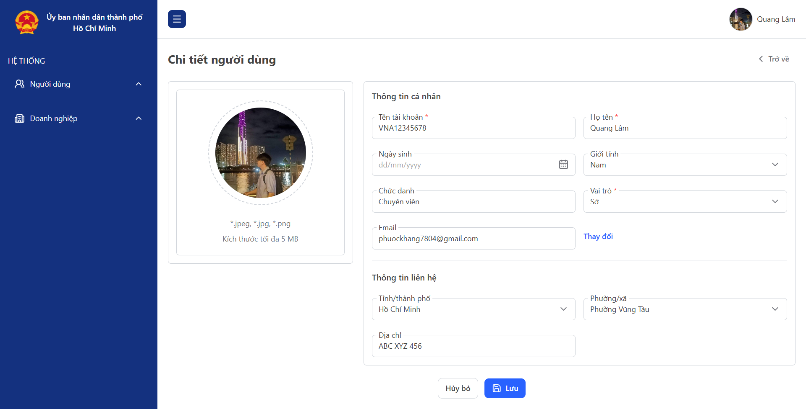
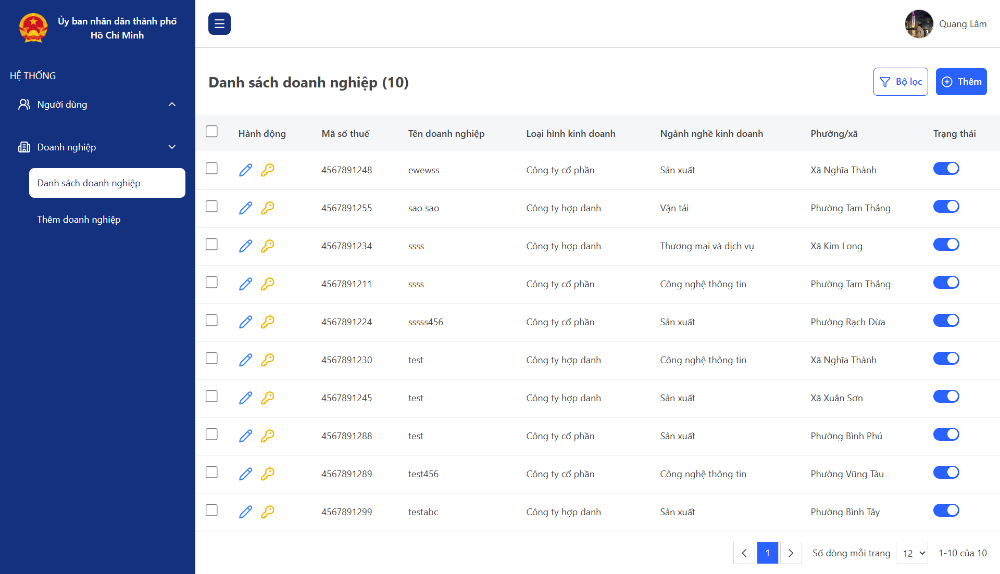

# THỰC TẬP CÔNG TY VNA GROUP - FRONTEND

## Công nghệ sử dụng

| Nhóm            | Thư viện                                                                  |
| --------------- | ------------------------------------------------------------------------- |
| Framework       | Next.js 16, React 19                                                      |
| Data fetching   | Axios, TanStack React Query                                               |
| Form & validate | React Hook Form, Zod                                                      |
| Xác thực        | js-cookie,jwt-decode                                                      |
| Giao diện       | Tailwind CSS, clsx, tailwind-merge, lucide-react, next-themes             |
| Tiện ích khác   | react-datepicker, date-fns, react-hot-toast, react-spinners, docx-preview |

## Tổng quan hệ thống

### Authentication

Hệ thống sử dụng JWT với access token và refresh token để xác thực người dùng và duy trì phiên đăng nhập. Access token dùng để xác thực API, refresh token dùng để cấp token mới khi access token sắp hết hạn. Cả hai token được lưu trong cookie để `proxy.ts` đọc được ở phía server.

Xử lý `axiosInstance`:

Việc gọi API được chia thành 2 instance Axios:

- `axiosPublic`: dùng cho các API không cần token.
- `axiosInstance`: dùng cho các API cần token, tự động gắn `Authorization: Bearer <accessToken>`.

Cơ chế tự động làm mới token:

- Refresh chủ động: trước khi gửi request, nếu access token sắp hết hạn thì gọi API refresh trước, sau đó gửi request với token mới.
- Refresh bị động: khi nhận lỗi `401`, hệ thống refresh token rồi gửi lại request đúng 1 lần.
- Refresh token rotation: mỗi lần refresh, backend trả về cặp token mới, frontend lưu lại cả hai.
- Dùng chung một lần refresh: khi nhiều request cùng gặp token hết hạn thì chỉ gọi 1 API refresh, các request còn lại chờ kết quả.
- Đồng bộ giữa nhiều tab bằng Web Locks API: tab khác đã refresh xong thì dùng token mới, không refresh lại.
- Tự động đăng xuất khi refresh token hết hạn hoặc bị backend từ chối, hoặc khi request đã gửi lại mà vẫn `401`. Lỗi mạng hoặc timeout khi refresh thì không đăng xuất.

### Phân quyền theo vai trò

Hệ thống có 2 vai trò là Sở và Doanh nghiệp. Mỗi vai trò có nhóm route riêng, việc chặn truy cập chéo vai trò được xử lý trong `proxy.ts`.

`proxy.ts` đọc `accessToken` và `refreshToken` từ cookie, giải mã để lấy vai trò của người dùng, sau đó điều hướng theo từng trường hợp:

- Chưa đăng nhập, vào route cần đăng nhập thì về `/`.
- Đã đăng nhập, vào route của vai trò khác thì về `/account`.
- Đã đăng nhập, vào route công khai (đăng nhập, quên mật khẩu, đăng ký doanh nghiệp) thì về `/account`.

### Chức năng chính

| Chức năng                | Hành động                          |
| ------------------------ | ---------------------------------- |
| **Xác thực**             | Đăng nhập                          |
|                          | Đăng xuất                          |
|                          | Khôi phục mật khẩu                 |
|                          | Đổi mật khẩu                       |
| **Quản lý người dùng**   | Lấy danh sách người dùng           |
|                          | Thêm người dùng                    |
|                          | Sửa người dùng                     |
|                          | Xóa nhiều người dùng               |
|                          | Bật/tắt trạng thái                 |
|                          | Khởi tạo mật khẩu                  |
|                          | Xem thông tin người dùng chi tiết  |
| **Quản lý doanh nghiệp** | Lấy danh sách doanh nghiệp         |
|                          | Thêm doanh nghiệp                  |
|                          | Sửa doanh nghiệp                   |
|                          | Đăng ký doanh nghiệp               |
|                          | Xem thông tin doanh nghiệp chi tiết|
| **Báo cáo TNLĐ**         | Báo cáo theo vai trò               |

## Thư mục

libs/

├── core/ ← CHỈ FE, dùng chung cho MỌI dự án FE

│ ├── models/ chứa type/interface/enum chỉ dùng phía FE và dùng chung cho nhiều dự án

│ │ └── component.model.ts ← SelectOption, TableColumn<T>

│ ├── hooks/ ← custom hook dùng lại được, không phụ thuộc nghiệp vụ

│ │ └── useDebounce.ts

│ ├── services/ ← cấu hình giao tiếp HTTP dùng chung

│ │ └── axiosInstance.ts ← axiosInstance + axiosPublic

│ ├── utils/ ← hàm tiện ích

│ │ └── validators.ts

│ │ └── formatters.ts

│ │ └── jwtUtil.ts

│ │ └── cookieUtil.ts

│ ├── constants/ ← hằng số dùng chung

│ │ └── limits.ts ← OTP_LENGTH, MAX_PASSWORD_LENGTH

│

├── shared/ ← FE + BE cùng dùng, đảm bảo 2 phía luôn khớp contract

│ └── core/ ← chung cho MỌI dự án

│ │ ├── models/

│ │ │ ├── common.model.ts ← ApiResponse, PageResponse, ErrorResponse

│ └── tts/ ← chung FE + BE, nhưng CHỈ cho dự án tts

│ │ ├── models/

│ │ │ ├── auth.model.ts ← LoginRequest, LoginResponse, ApiResponse...

│ │ │ ├── params.model.ts

│ │ ├── schemas/ Zod schema

│ │ │ ├── auth.schema.ts ← loginSchema, registerSchema, verifyOtpSchema...

│

└── tts/ source riêng của dự án tts

│ └── assets/ logo, banner, nền

│ └── components/ component chỉ dự án này dùng

│ └── services/

│ │ │ ├── apis/

│ │ │ │ ├── authApi.ts

│ └── hooks

│ │ ├── useAuth.ts ← useLogin, useRegister, useLogout...

│ └── providers/ các providers

│ │ ├── QueryProvider.tsx

│ │ ├── AppProvider.tsx
